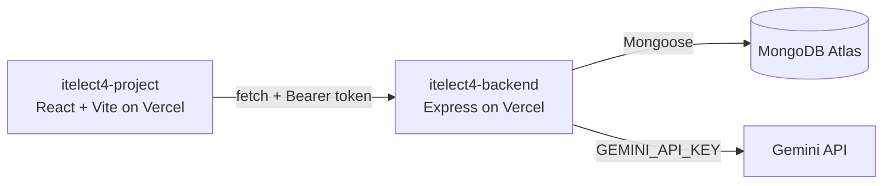

# itelect4-backend

[](https://github.com/itsyogooey/itelect4-backend/actions/workflows/ci.yml)

The REST API behind **Campus Lost and Found**, a De La Salle Lipa app for reporting items lost or found on
campus: Express 5 in TypeScript, MongoDB Atlas through Mongoose, JWT login, public campus locations, private
items per account, and one route that asks Google Gemini to turn a messy item description into a clean
report draft.

- **Live API:** https://itelect4-backend-peach.vercel.app/api/health
- **Live site:** https://itelect4-project-it-4-b.vercel.app
- **Frontend repo:** https://github.com/itsyogooey/itelect4-project-IT4B

## Architecture



## How to run it locally

Needs Node 22.12 or newer.

```bash
npm install
copy .env.example .env     # fill in MONGODB_URI, JWT_SECRET, GEMINI_API_KEY; CORS_ORIGIN=http://localhost:5173
npm run seed               # puts the campus locations into Atlas (safe to run twice)
npm run dev                # http://localhost:4000
npm run try-ai             # one real Gemini call from the terminal
```

## Tests

```bash
npm test                   # Vitest + Supertest: tests/ai.test.ts, 3 tests
```

`tests/ai.test.ts` sends real requests to the Express app (no port, no database, no Gemini call):
no token gives `401`, a forged token gives `401`, and a valid token gets past `requireAuth` to the
request schema (`400`). GitHub Actions runs `npm ci`, the type check and the tests on every push
(`.github/workflows/ci.yml`), with `JWT_SECRET` from the repository's Actions secrets.

## Endpoints

### `POST /api/auth/register`

Request:

```json
{"name":"Alex Student","email":"alex@example.com","password":"a-long-password"}
```

Response `201`:

```json
{"id":"665f00000000000000000001","name":"Alex Student","email":"alex@example.com","role":"student","isActive":true}
```

### `POST /api/auth/login`

Request:

```json
{"email":"alex@example.com","password":"a-long-password"}
```

Response `200`:

```json
{"token":"<jwt>","user":{"id":"665f00000000000000000001","name":"Alex Student","email":"alex@example.com","role":"student","isActive":true}}
```

### `GET /api/items`

Header: `Authorization: Bearer <token>`

Response `200`: `[{"id":"665f00000000000000000002","title":"Blue backpack","status":"lost","locationCode":"LIB","createdAt":"2026-10-08T12:00:00.000Z","ownerId":"665f00000000000000000001"}]`

### `GET /api/items/:id`

Header: `Authorization: Bearer <token>`

Response `200`: `{"id":"665f00000000000000000002","title":"Blue backpack","status":"lost","locationCode":"LIB","createdAt":"2026-10-08T12:00:00.000Z","ownerId":"665f00000000000000000001"}`. Missing or another user's item returns `404`.

### `POST /api/items`

Header: `Authorization: Bearer <token>`

Request:

```json
{"title":"Blue backpack","status":"lost","reward":25,"locationCode":"LIB"}
```

Response `201`: the created item, including its generated `id`, `createdAt`, and token-derived `ownerId`.

### `PATCH /api/items/:id`

Header: `Authorization: Bearer <token>`

Request: `{"status":"found"}`

Response `200`: the updated item. Missing or another user's item returns `404`.

### `DELETE /api/items/:id`

Header: `Authorization: Bearer <token>`

Response `204` with no body. Missing or another user's item returns `404`.

`GET /api/health` is also available without authentication and reports whether MongoDB is connected.


## AI-use disclosure

AI tools were used while building this project:

- **Claude (Anthropic)** gave step-by-step guidance and drafted code for GT4–GT6, which I applied, ran and tested.
- **GitHub Copilot** (VS Code, Agent mode) ran the git and npm steps and applied the code changes.
- **Google Gemini** is part of the app itself: `POST /api/ai` asks it for a report draft.

I reviewed and tested every change and can explain the code in this repository.
